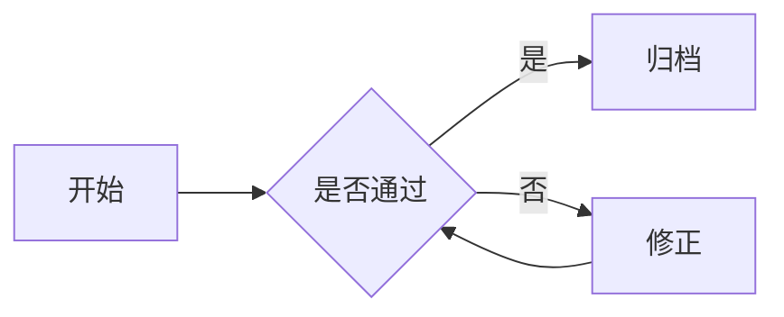

# Markdown 转换工具（多格式导出）

本地运行的 Markdown 转换小工具：自带**中文操作页面**（左输入 / 中实时预览 / 右选格式并下载），
把一份 Markdown 一键转成 **PDF / Word / PPT / PNG / JPG** 五种格式，全部支持中文，
并自动把 ```` ```mermaid ```` 代码块渲染为**矢量图 / 插图**（PDF / PNG / JPG 出矢量图，
PPT 图文混排、Word 插入渲染图，全格式支持）。

## 一、解决什么问题

写 Markdown 很快，但真正要「交付 / 分享 / 归档」时常常卡在格式上：

- 想发一篇**正式文档**（合同、报告、说明）→ 需要可直接打印归档的 **PDF**，但 Markdown 排版粗糙、中文乱码；
- 想交给同事**继续编辑** → 需要结构化的 **Word(.docx)**，而不是一堆 `#` 和 `|`；
- 要做**汇报 / 演示** → 需要把大纲直接变 **PPT(.pptx)**，手动重排幻灯片太费时间；
- 想在群里**快速分享** → 想要一张排版好的**长图**（PNG/JPG），比截图方便、比链接体面。

这个工具把这些需求合并成「粘贴一份 Markdown，选一个格式，点一下下载」，且全程**纯本地运行，
数据不出本机**，无需注册、无需上传到第三方服务。

## 二、主要功能

### 1. 中文三板块操作界面

| 板块 | 作用 | 行为 |
| ---- | ---- | ---- |
| 左 · 输入区 | 粘贴 / 上传 `.md` | 文本框固定高度，内容过多时内部滚动，整页不被拉长 |
| 中 · 实时预览 | 输入即所见 | 渲染效果与 **PDF 输出完全一致**（同一套排版样式） |
| 右 · 输出格式 | 选格式 + 一键下载 | 五个格式卡片；选中 PPT 时额外出现 6 款配色模板 |

- **预览即所见**：中栏注入的 CSS 与 PDF 渲染共用同一份 `LAYOUT_CSS`，保证「预览什么样，导出就什么样」。
- **PPT 模板选择**：内置 6 款配色（简约商务 / 科技深蓝 / 活力橙 / 清新绿 / 黑金尊享 / 创意紫），
  各带创意背景图（放射 / 透视网格 / 电路 / 太阳光芒 / 山峦 / Art Deco 星轨等），
  文字区叠加半透明面板保证深色背景下的可读性。

### 2. 五种导出格式

| 格式 | 输出文件 | 特点 |
| ---- | -------- | ---- |
| **PDF** | `.pdf` | 微软雅黑、段落首行缩进、层级标题、表格隔行变色、代码块灰底圆角、引用蓝边浅底；A4 分页，代码块/表格避免跨页断裂；mermaid 图渲染为矢量 |
| **Word** | `.docx` | 标题 / 列表 / 表格 / 代码 / 引用**结构化**导出，中文统一微软雅黑，可继续编辑；mermaid 渲染成图**插入**文档 |
| **PPT** | `.pptx` | 大纲转 16:9 幻灯片：`#` 作封面 / 分节页，`##` 作内容页，要点过多自动拆「(续)」页，右下角自动页码；**mermaid 图与文字要点图文混排** |
| **PNG** | `.png` | 渲染为一张排版好的长图，透明无损；mermaid 图渲染为矢量 |
| **JPG** | `.jpg` | 长图，压缩后体积小，适合分享；mermaid 图渲染为矢量 |

> PDF / PNG / JPG 通过**本机 Microsoft Edge 无头模式**渲染（无需额外下载浏览器）；
> 找不到 Edge 时自动回退到 Playwright Chromium（需先 `playwright install chromium`）。

### 3. 流程图（mermaid）自动渲染

```` ```mermaid ```` 代码块在**全部五种格式**中自动渲染：

| 格式 | 渲染方式 |
| ---- | -------- |
| PDF / PNG / JPG | 渲染为**矢量 SVG** 嵌入版面 |
| PPT | **图文混排**：mermaid 渲染成透明 PNG 图，与文字要点按序排布在同一内容页 |
| Word | 渲染成 PNG 图，用 `add_picture` **插入**文档段落流 |

mermaid.js 认识的所有图类型**全部支持**，不限于流程图：

| 图类型 | 语法关键字 | 是否支持 |
| ------ | --------- | -------- |
| 流程图 | `flowchart` / `graph` | ✅ |
| 时序图 | `sequenceDiagram` | ✅ |
| 类图 | `classDiagram` | ✅ |
| 状态图 | `stateDiagram-v2` | ✅ |
| 甘特图 | `gantt` | ✅ |
| ER 图 | `erDiagram` | ✅ |
| 饼图 | `pie` | ✅ |

- **本地内嵌 `assets/js/mermaid.min.js`**（离线，不引外部 CDN），符合「数据不出本机」原则；
- 渲染失败时优雅降级：PDF/PNG/JPG 显示带源码的错误块，PPT/Word 该图降级为文本，均不阻断其他内容；
- **自动补全未闭合围栏**：漏写结尾 ``` 时自动补上，整块不会退化成纯文本；
- 中栏**实时预览**同步支持：输入含 mermaid 块时，前端按需懒加载本地 mermaid.js，
  把源码渲染成与导出一致的矢量图（所见即所得）；
- 其它语言代码块（` ```python ` 等）在 PPT/Word 中仍降级为文本要点，行为不变。

### 4. 纯本地、可复核

所有转换在本机完成，无网络依赖；随附 `verify.py` 一键自检，覆盖各格式渲染核心、
mermaid 图渲染、三板块页面、全部 API 与 PPT 模板选择。

### 5. 性能：共享浏览器加速

PDF / PNG / JPG / mermaid 都靠无头浏览器出图。若每次转换都冷启动一次浏览器，
光启动就 2~4 秒，连续下载会明显卡顿。本工具用一个**进程级共享浏览器**解决：

- 服务启动后常驻**一个**无头浏览器（本机 Edge 优先，缺失回退 Chromium），
  放在专用线程里；各次转换复用同一实例，**零冷启动**；
- 后续每次转换实测约 **2.5~3.5 秒**（含多张 mermaid 图渲染），不再随请求线程漂移；
- 浏览器异常掉线时自动重建并重试，`atexit` 统一回收，不泄漏进程。

## 三、安装方法

1. 安装 Python 依赖：

   ```bash
   pip install -r requirements.txt
   ```

   依赖包含：`fastapi`、`uvicorn`、`markdown`、`playwright`、`python-docx`、`python-pptx` 等。

2. （可选）如果没有 Microsoft Edge，可安装 Chromium 作为渲染回退：

   ```bash
   playwright install chromium
   ```

   已装 Edge 的机器可跳过此步，工具会优先使用本机 Edge。

### Docker 部署（可选）

没有 Python 环境也可以直接跑容器（镜像内置 Playwright Chromium + Noto CJK 字体 + 离线 mermaid.js）：

```bash
# 构建
docker build -t md-converter .

# 运行(宿主机 8000 映射到容器 8000)
docker run -d --name md-converter -p 8000:8000 md-converter
```

浏览器打开 **http://localhost:8000** 即可使用。说明：

- 容器内无 Edge，PDF/PNG/JPG 自动走 **Playwright Chromium 回退**（镜像已装好，无需再执行任何命令）；
- 内置 `HEALTHCHECK`，`docker ps` 里状态为 `healthy` 即服务就绪；
- 以非 root 用户运行（`--no-sandbox` 已内置，普通 Docker 环境直接可用；
  如需自定义浏览器参数，可覆盖 `BROWSER_EXTRA_ARGS` 环境变量）；
- GitHub Actions 有 **Docker build check** 工作流，每次改动 Dockerfile 自动构建 +
  起容器 + 健康检查 + mermaid PDF 转换冒烟，保证镜像始终可用。

## 四、使用方法

### 启动服务

```bash
uvicorn main:app --host 127.0.0.1 --port 8000
```

浏览器打开 **http://127.0.0.1:8000** 即可看到中文操作页面。

### 页面操作

1. **左栏**：粘贴 Markdown，或点「上传 .md」选择本地文件；也可点「加载示例」载入内置示例。
2. **中栏**：输入停止 250ms 后自动刷新，实时预览排版效果。
3. **右栏**：
   - 选择要导出的格式（默认 PDF）；
   - 若选 **PPT**，下方会显示 6 款配色模板，点卡片切换；
   - 点底部「⬇ 下载 XX」按钮，浏览器直接下载生成的文件。

### 本地验证

```bash
python verify.py
```

一次运行约 33 项检查（各格式渲染核心 + 三板块页面 + 全部 API + PPT 模板选择 + mermaid 图渲染 + PPT 图文混排 + Word 插图 + DOM 级渲染断言），
全部通过时输出「全部验证通过」。

## 五、输入 / 输出示例

**输入**（`sample.md`，节选）：

````markdown
# Markdown 转 PDF 排版测试

这是**加粗**、*斜体*、`行内代码` 以及普通正文段落。

## 表格（隔行变色）

| 名称 | 数量 | 备注 |
| ---- | ---- | ---- |
| 苹果 | 3    | 红色 |

```python
def hello():
    print("Hello, 中文世界!")
```

## 流程图（自动渲染）


````

**输出**：同一份输入可分别得到 5 种文件——

| 选格式 | 得到文件 | 内容形态 |
| ------ | -------- | -------- |
| PDF | `Markdown 转 PDF 排版测试.pdf` | A4 多页文档，标题居中、表格隔行、代码块灰底；**mermaid 图渲染为矢量** |
| Word | `…排版测试.docx` | 可在 Word 中继续编辑的结构化文档；**mermaid 渲染成图插入** |
| PPT | `…排版测试.pptx` | 封面页（主标题+日期）+ 各 `##` 内容页，右下角带页码；**mermaid 图与要点图文混排** |
| PNG | `…排版测试.png` | 一张完整长图；**mermaid 图渲染为矢量** |
| JPG | `…排版测试.jpg` | 同上，压缩体积；**mermaid 图渲染为矢量** |

> 文件名取 Markdown 中**第一个一级标题（`# `）**，没有一级标题则用「文档 / 演示文稿」兜底。

## 六、API 一览

| 方法 | 路径 | 说明 |
| ---- | ---- | ---- |
| `GET` | `/` | 中文操作页面（左输入 / 中预览 / 右格式+下载） |
| `POST` | `/api/convert` | 表单 `md` + `format`（pdf/word/pptx/png/jpg）＋ `template`（仅 PPT）→ 返回文件下载 |
| `GET` | `/api/html-preview` | 中栏实时预览用，返回渲染 HTML 片段 + 排版 CSS；含 mermaid 块时附 `mermaid: true` 标记 |
| `GET` | `/api/formats` | 可用格式列表 |
| `GET` | `/api/ppt-templates` | PPT 可选配色模板列表 |
| `GET` | `/api/sample` | 示例 Markdown |
| `GET` | `/assets/js/mermaid.min.js` | 本地离线 mermaid.js（中栏预览懒加载，不引外部 CDN） |
| `GET` | `/health` | 健康检查 |

## 七、目录结构

```
main.py            # FastAPI 服务：页面 + /api/* 接口
renderer.py        # 渲染核心：PDF / Word / PPT / PNG / JPG（含 mermaid 图自动渲染）
make_backgrounds.py# 生成 6 款 PPT 背景图（assets/ppt_bg/*.png）
web/index.html     # 中文三板块页面（左输入 / 中预览 / 右格式+下载，含 mermaid 预览）
verify.py          # 一键验证脚本
sample.md          # 示例 Markdown（含 mermaid 流程图）
test_sample.md     # 二次开发验收文档（5 种图型 + 未闭合围栏边界）
requirements.txt   # 依赖
assets/ppt_bg/     # 6 款 PPT 背景图（PNG）
assets/js/         # 本地离线 mermaid.min.js（流程图渲染，不引外部 CDN）
Dockerfile         # 容器镜像（内置 Chromium + Noto CJK 字体）
.github/workflows/ # CI 自动验证(33 项) + Docker 构建冒烟检查
output/            # 验证脚本产出的样例文件（可删）
LICENSE            # MIT 许可证
```

## 许可证

本项目采用 **MIT License**，详见 [LICENSE](LICENSE)。
