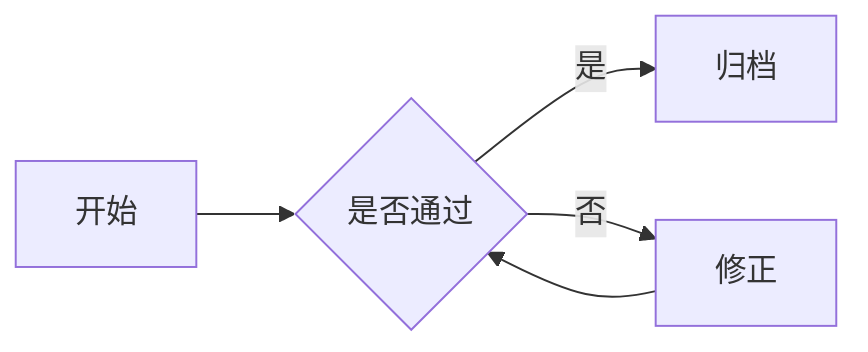

# Markdown 转 PDF 排版测试

这是**加粗**、*斜体*、`行内代码` 以及普通正文段落。正文段落应有首行缩进、两端对齐，行距适中，阅读舒适。

## 二级标题（左侧蓝色竖条）

列表项也应排版良好，层级清晰：

- 第一层项目一
- 第一层项目二
  - 第二层子项目
  - 第二层子项目

## 表格（隔行变色）

| 名称 | 数量 | 备注 |
| ---- | ---- | ---- |
| 苹果 | 3    | 红色 |
| 香蕉 | 5    | 黄色 |

## 代码块（灰底圆角）

```python
def hello():
    print("Hello, 中文世界!")
```

## 流程图（mermaid，自动渲染）



> 这是一段引用文字，带蓝色左边条与浅蓝底色。

---

[链接示例](https://example.com)
