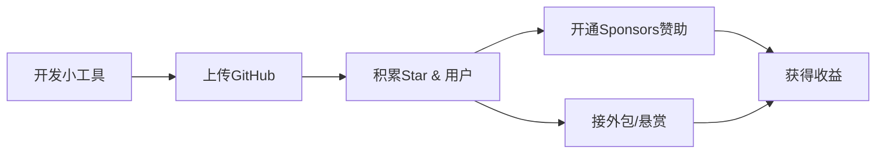
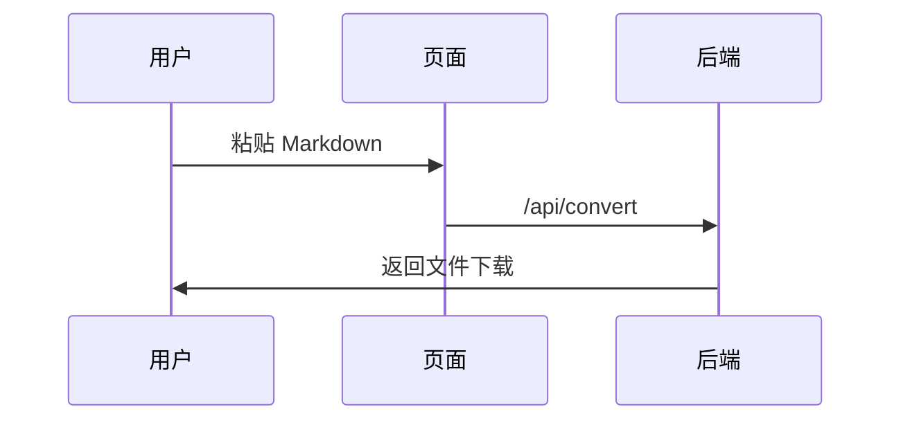
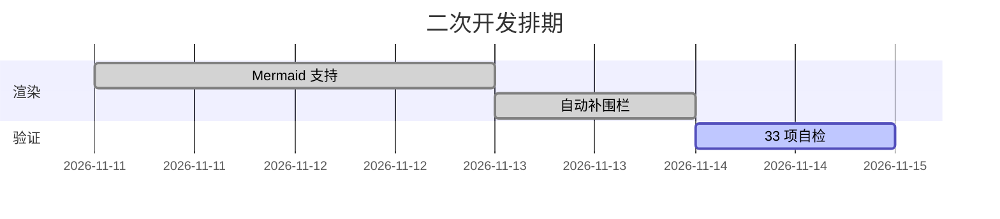
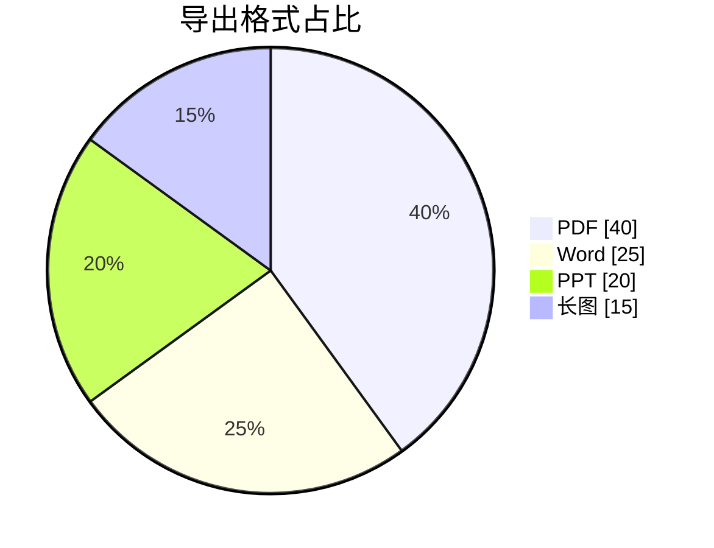

# 二次开发验收测试文档

这是**加粗**、*斜体*、`行内代码`，以及一张 [示例链接](https://example.com)。

## 一、基础排版

- 列表项 A
- 列表项 B
  - 子项 B1
  - 子项 B2

1. 有序一
2. 有序二

| 格式 | 文件 | mermaid |
| ---- | ---- | ------- |
| PDF  | .pdf | ✅ 矢量 |
| Word | .docx | ✅ 插图 |
| PPT  | .pptx | ✅ 图文混排 |

> 这是一段引用，验证左蓝边浅底。

```python
def hello():
    print("Hello, 中文世界!")
```

## 二、mermaid：已闭合围栏（正常写法）



## 三、mermaid：时序图（sequenceDiagram）



## 四、mermaid：甘特图（gantt）



## 五、mermaid：饼图（pie）



## 六、mermaid：未闭合围栏（故意漏写结尾 ```，验证自动修复）

```mermaid
graph TD
    S[开始] --> P{自动补围栏}
    P -->|是| OK[正常渲染]
    P -->|否| ERR[显示错误块]
